# Máquina de Estáticos

Você manda uma pasta com o pedido (.docx) e os anúncios de referência; a máquina cria os anúncios estáticos da sua marca em **9:16 (story)** e **1:1 (feed)** usando o Google Flow, um de cada vez, e entrega tudo numa pasta pronta.

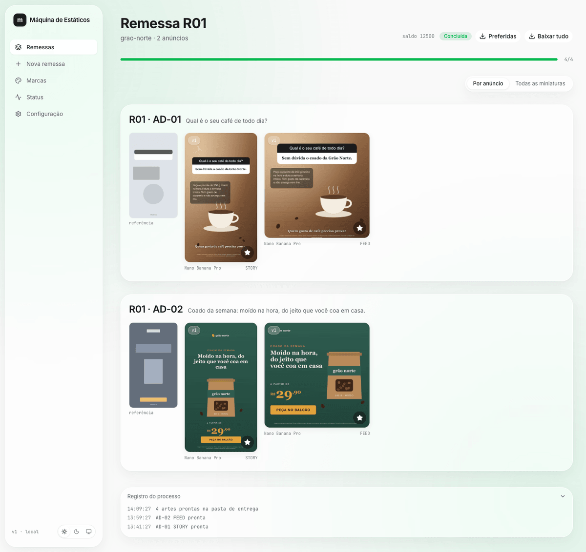

*Demonstração com a marca inventada Grão Norte: as artes acima são ilustrativas, desenhadas para este exemplo (não foram geradas pelo Flow).*

Você não precisa saber programar: quem instala e liga o sistema é o **Claude Code**. Você só copia uma frase, responde ao que ele perguntar e entra na sua conta Google.

---

## Antes de começar

- [ ] Um computador **Mac** ou **Windows** com pelo menos **3 GB livres** em disco.
- [ ] O **Claude Code** instalado e com login feito: [claude.com/claude-code](https://claude.com/claude-code).
- [ ] Uma **conta Google com o plano Ultra do Flow**, em que gerar imagens não gasta créditos: [labs.google/fx/tools/flow](https://labs.google/fx/tools/flow).

O resto (Node, Python, Chrome, Git) o Claude instala para você, sempre pedindo licença antes. Algumas instalações você mesmo confirma: digitando a senha do computador (Mac) ou clicando em **Sim** na janela do Windows.

---

## Passo a passo

### 1. Pegue o endereço do projeto

O endereço é **https://github.com/mt3x/maquina-de-estaticos** e já vem pronto na frase do passo 2. Se quiser pegar direto no GitHub: botão verde **Code** → **HTTPS** → copiar.

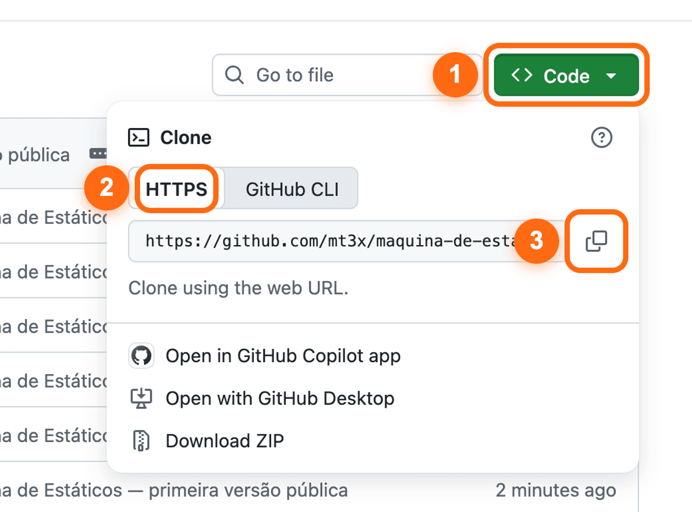

### 2. Peça ao Claude para instalar

Abra o terminal e digite `claude` + Enter. No **Mac**: aperte **⌘ + Espaço**, digite `Terminal` e Enter. No **Windows**: aperte a tecla **Windows**, digite `PowerShell` e Enter.

Copie a frase abaixo, cole e aperte Enter. O Claude guarda o projeto na sua pasta pessoal (a pasta com o seu nome), numa pasta chamada `maquina-de-estaticos`.

```
instale o projeto https://github.com/mt3x/maquina-de-estaticos no meu computador e siga o CLAUDE.md dele
```

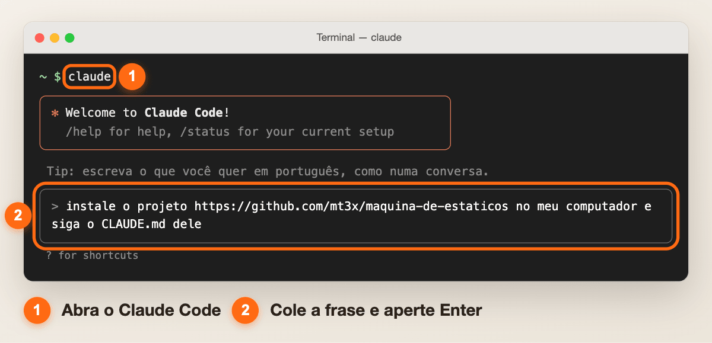

### 3. Responda ao que o Claude perguntar

Antes de instalar qualquer programa, o Claude mostra o comando e explica o que ele faz; se concordar, escolha **Yes** (ou responda "pode"). Se ele pedir para **você** rodar um comando (porque pede a senha do computador), cole o comando no Terminal/PowerShell, digite a senha e avise quando terminar.

**No Mac:** se faltar o Homebrew (o instalador de programas do Mac), o Claude pede para **você** abrir o Terminal (⌘ + Espaço, `Terminal`, Enter), colar o comando que ele mostrar e digitar a senha do computador (ela não aparece enquanto você digita).

**No Windows:** cada instalação abre a janela "Deseja permitir…?" — clique em **Sim**. Depois o Claude mostra o caminho da pasta do projeto e pede para você:

1. fechar a janela **inteira** do PowerShell (não só o Claude Code);
2. abrir uma janela **nova** do PowerShell;
3. digitar `cd "<o caminho que o Claude mostrou>"` e Enter, depois `claude` e Enter;
4. escrever **continue a instalação**. Ele segue de onde parou.

Se o Claude ainda não tinha baixado o projeto (por exemplo, logo depois de instalar o Git), não há caminho: abra a janela nova, digite `claude` e cole de novo a frase do passo 2.

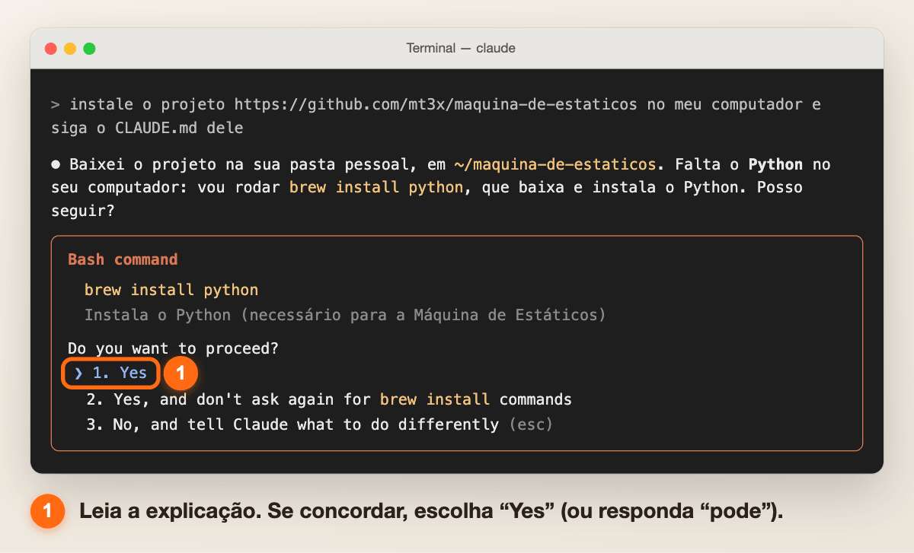

### 4. Entre na sua conta do Flow

O Claude abre uma janela do Chrome no Flow. **Você** digita o e-mail e a senha da sua conta Google — nunca passe a senha para o Claude.

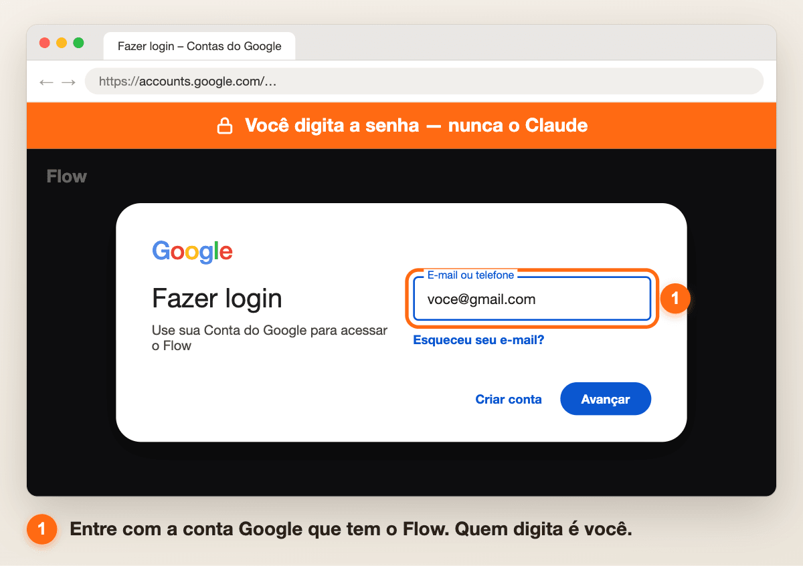

### 5. Crie um projeto no Flow e mande o link

Nessa mesma janela, clique em **New project**.

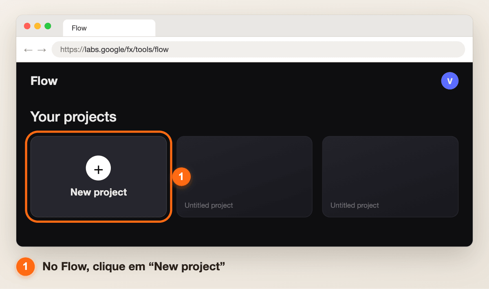

Copie o endereço inteiro da barra do navegador e cole na conversa com o Claude.

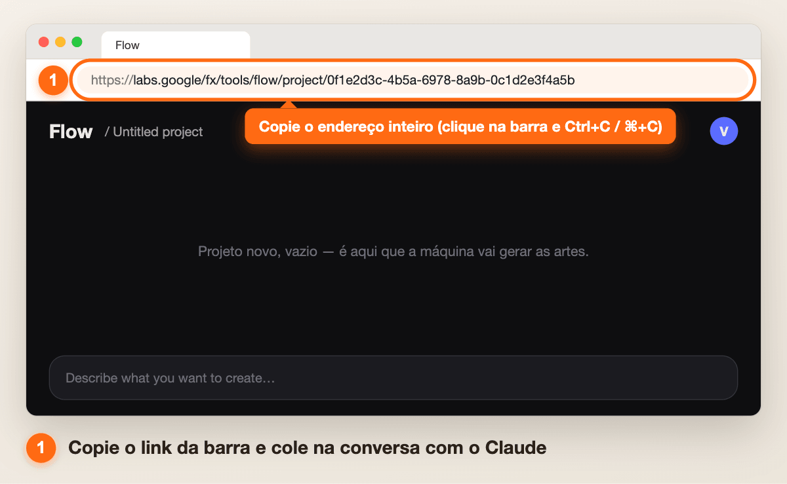

### 6. Pronto!

O Claude liga o sistema e avisa. Abra **http://127.0.0.1:3200** no navegador: na tela **Status**, tudo verde quer dizer que está funcionando.

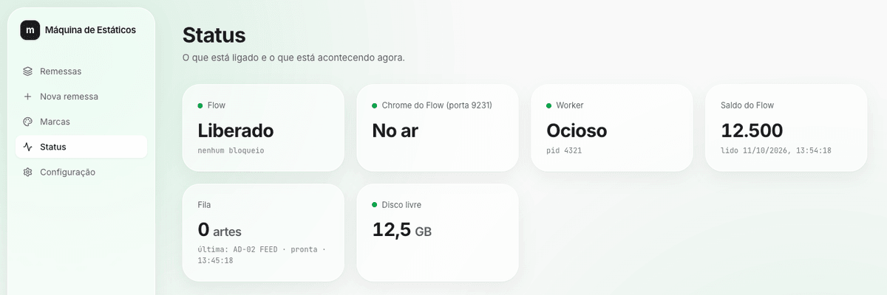

### 7. Cadastre a sua marca

Vá em **Marcas → Nova marca**.

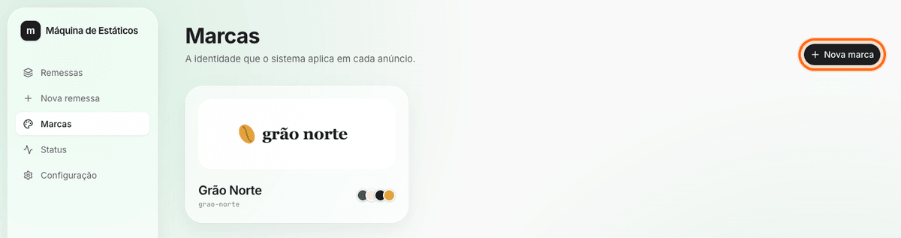

Dê o nome, arraste uma pasta com anúncios da marca, envie o logo (PNG transparente) e o aviso legal, e clique em **Extrair identidade**. O sistema lê cores, fontes e estilo; você revisa e clica em **Salvar marca**.

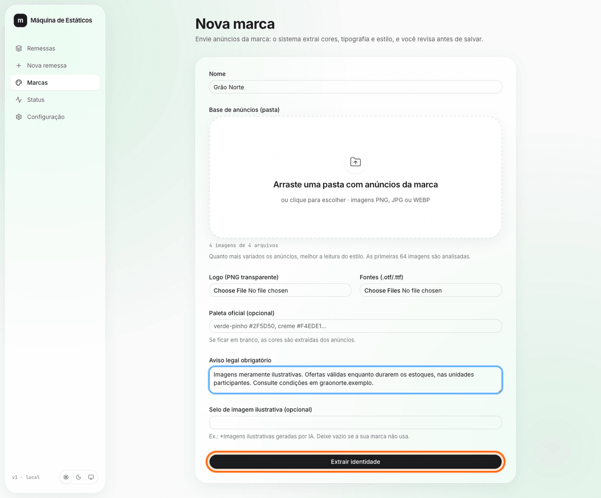

### 8. Faça a primeira remessa

Em **Nova remessa**, arraste a pasta com o pedido (.docx), as referências (`ref-1`, `ref-2`…) e o material de apoio, escolha a marca e clique em **Enviar remessa**. O sistema mostra as dúvidas antes de gerar qualquer coisa.

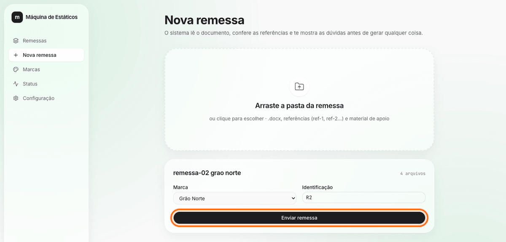

As artes aparecem conforme ficam prontas. Clique numa arte para ver grande, pedir ajuste ou marcar a preferida; no fim, **Baixar tudo**.


### 9. No dia a dia

Abra o Terminal/PowerShell, entre na pasta do projeto, digite `claude` e diga **inicia o sistema**. Para desligar, diga **desliga o sistema** ou feche o Claude Code.

- Mac (Terminal): `cd ~/maquina-de-estaticos`
- Windows (PowerShell): `cd "$HOME\maquina-de-estaticos"`

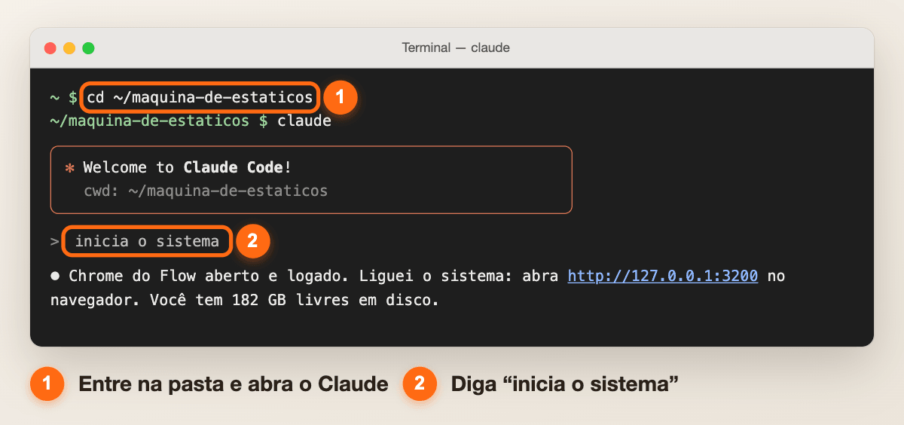

> Se não souber onde ficou o projeto, abra o `claude` em qualquer pasta e pergunte em que pasta ele instalou a Máquina de Estáticos.

---

## Deu problema?

| O que aparece | O que fazer |
|---|---|
| **Chrome fechado** — na tela Status, "Chrome do Flow: Fora do ar" | Clique em **Abrir Chrome do Flow** na tela Status, ou diga ao Claude "inicia o sistema". |
| **Flow deslogado** — a janela do Chrome mostra o login do Google e nada é gerado | Entre você mesmo na janela do Chrome do Flow. O Claude nunca digita a sua senha. |
| **Faixa vermelha no topo** — "O Flow sinalizou bloqueio — tudo parado para proteger a conta" | O Flow recusou um pedido (403, atividade incomum, custo…). Abra o Flow no Chrome e confira a sua conta; só depois clique em **Desbloquear** na tela Status. Se voltar a acontecer, espere algumas horas. |
| **Python** — na tela Configuração, "Python não encontrado" ou "é antigo" | Diga ao Claude "instala o que está faltando". Ele mostra o comando (`brew install python` no Mac, `winget install … Python.Python.3.12` no Windows) e pede licença. |
| **Claude não logado** — em Configuração → **Testar Claude**, "Claude Code sem login" | Abra o Terminal/PowerShell, digite `claude` e faça o login na sua conta. |

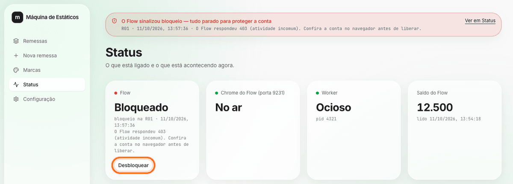

A tela **Configuração** (http://127.0.0.1:3200/configuracao) mostra o que está instalado e aceita o link do projeto do Flow, sem precisar do Claude.

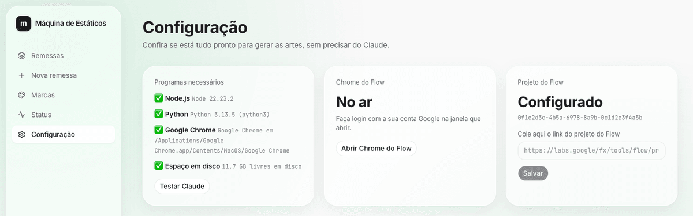

---

## Segurança da sua conta do Flow

A máquina foi feita para usar o Flow com calma, como uma pessoa usaria:

- **Uma geração por vez**, com pausa de **45 a 60 segundos** entre uma e outra (a pausa vale mesmo depois de desligar e ligar de novo).
- **Para tudo no primeiro sinal de problema**: erro 403 ou 429, aviso de atividade incomum, recusa por política ou qualquer geração que **custe créditos**. Nada mais sobe nem gera, em nenhuma remessa, até você conferir a conta e clicar em **Desbloquear**.
- **No máximo 3 tentativas por arte**; depois disso, só se você pedir "Gerar de novo".

Mesmo assim, o uso é **por sua conta e risco**: automatizar o Flow pode não ser aceito pelo Google, e a sua conta pode ser limitada. O sistema só serve para um plano em que gerar imagens **não custa créditos**; se custar, ele para.

---

## Para quem é técnico

Instalação manual (Node ≥ 20.12, Python ≥ 3.10, Google Chrome, Claude Code logado):

```bash
git clone https://github.com/mt3x/maquina-de-estaticos && cd maquina-de-estaticos
npm run verificar                         # confere os pré-requisitos (✅/❌ e como resolver)
npm run instalar                          # dependências Node e Python (.venv), build, .env.local e dados/
npm run chrome                            # abre o Chrome do Flow (porta 9231): faça login
npm run configurar -- "<link do projeto do Flow>"
npm start                                 # interface + worker em http://127.0.0.1:3200
```

**Testes:** `npm test` (vitest; usa um Claude CLI falso e um driver do Flow falso — nada vai ao Flow). `npm run checar-publico` confere se nenhum dado privado entrou nos arquivos versionados.

**Pastas:**

| Pasta | O que tem |
|---|---|
| `app/` | interface (Next.js) e API |
| `components/`, `lib/` | componentes da interface e código compartilhado |
| `worker/` | fila, "cérebro" (Claude CLI) e pós-processamento |
| `motor-flow/` | Chrome do Flow e driver Playwright; scripts Python de aviso legal, logo e selo |
| `scripts/` | verificar, instalar, configurar, checar-publico; `imagens-readme/` gera as imagens deste README |
| `dados/` | marcas e remessas (fora do git) |
| `test/` | testes e fakes |

As instruções que o Claude segue estão em [CLAUDE.md](CLAUDE.md). Testado no Mac; o Windows é validado pela CI.

## Licença

[MIT](LICENSE)
